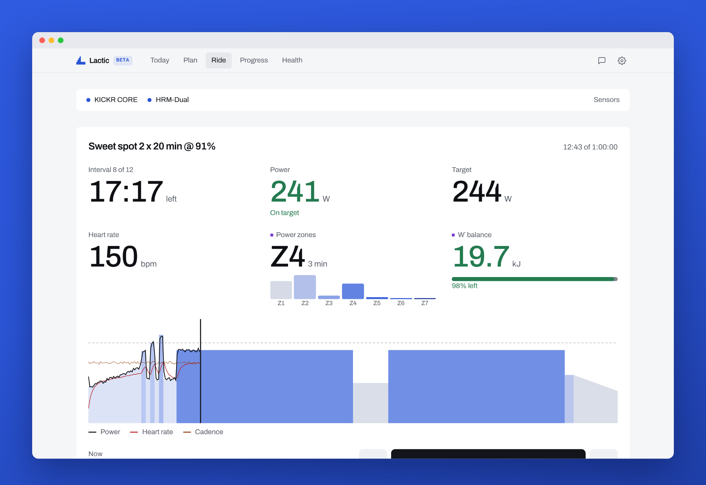
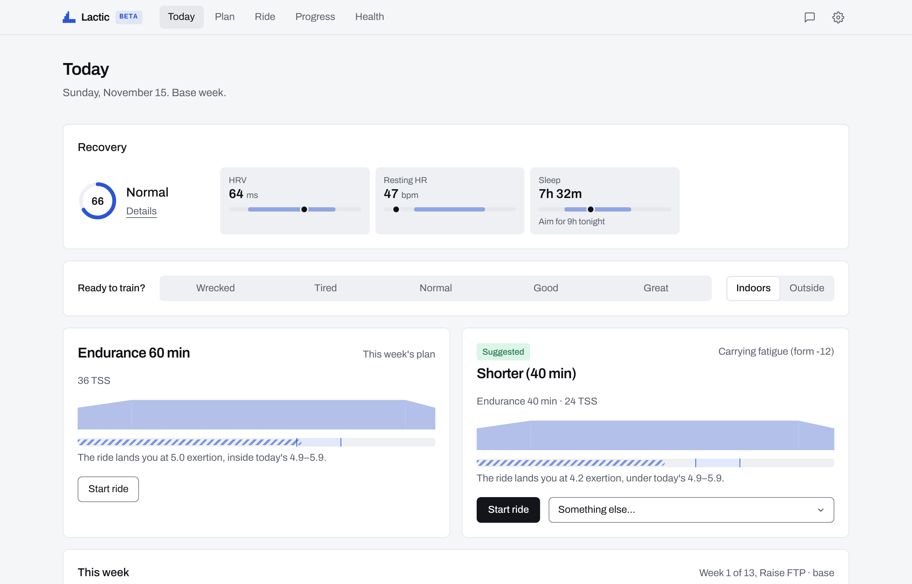
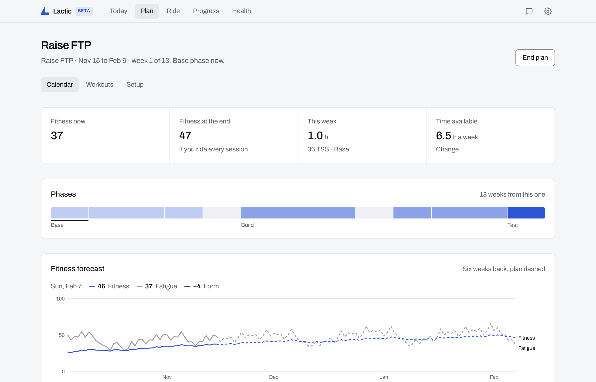
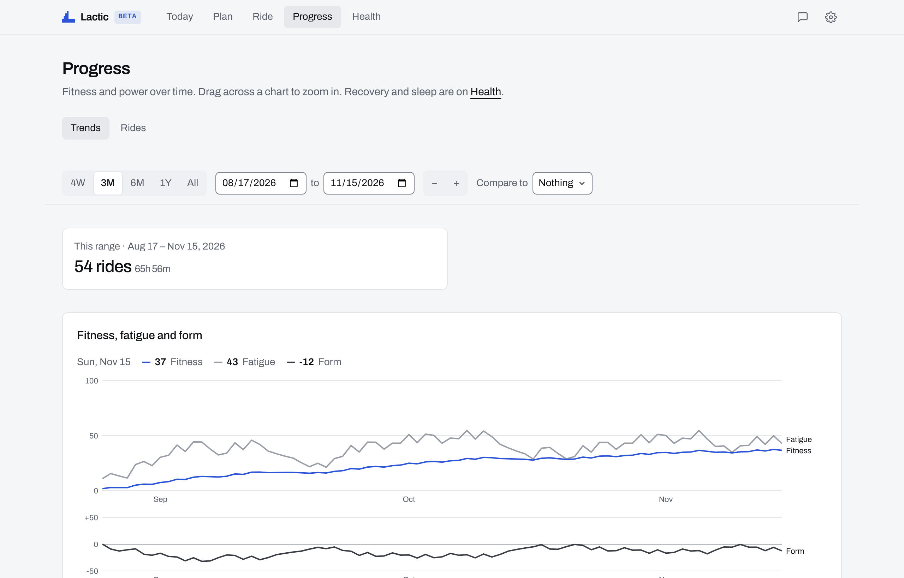
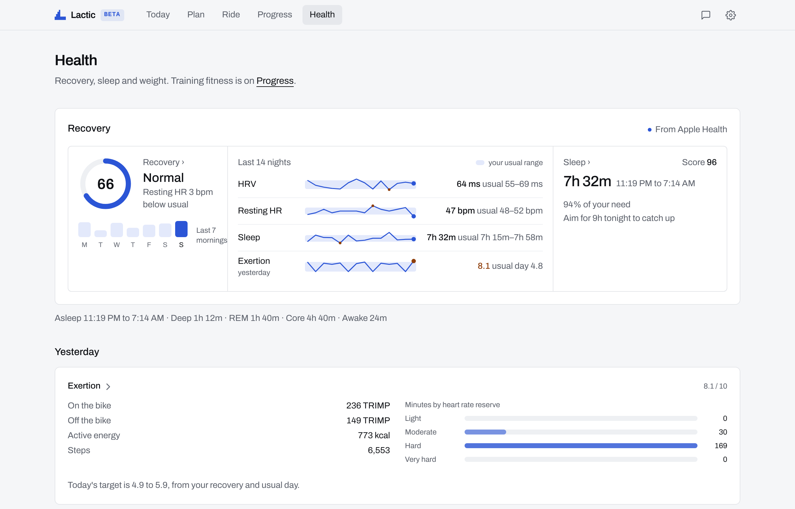
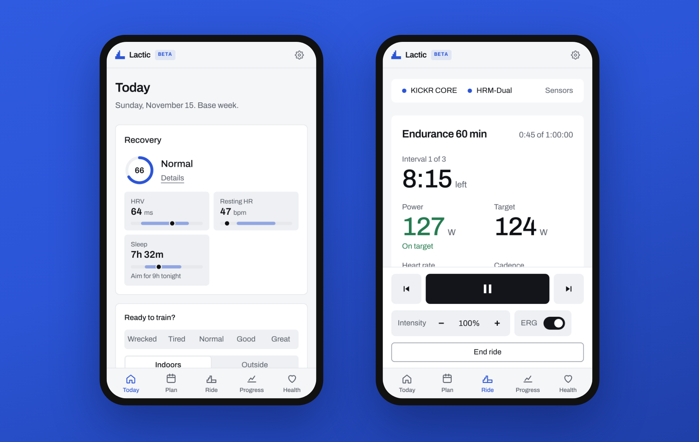

<div align="center">


# Lactic <sup><sub>BETA</sub></sup>

**The open-source training platform.**

A training plan that fits your week, workouts on your smart trainer, and your recovery in one place.<br>
Free, on your computer, with the AI coach of your choice. Or none.

_Lactic is in beta. Expect a few rough edges, and please [open an issue](https://github.com/blairj09/lactic/issues/new/choose) or press **Feedback** in the app when something's off._

[**Download**](https://github.com/blairj09/lactic/releases/latest) · [Try it in your browser](https://lactic.fit/ride) · [iPhone beta](https://testflight.apple.com/join/nDjt8pAG) · [lactic.fit](https://lactic.fit) · [Plugins](plugins/) · [Contributing](CONTRIBUTING.md) · [MIT licensed](LICENSE)

On a Mac with [Homebrew](https://brew.sh):

```sh
brew install --cask blairj09/lactic/lactic
```

</div>

<p align="center">
  
</p>

---

- **A plan that fits your life.** Your goal, the time you have each day, and the weeks to get there.
- **Every interval on target.** ERG on your smart trainer, with an overlay on top of Zwift or anything else.
- **Train for the day you're having.** A morning recovery score from your watch, and a plan that adjusts to it.
- **Make it yours.** Arrange Today, choose your ride fields, add plugins.
- **A coach that knows your numbers.** Built-in, the AI app you already use, or none. It suggests; you apply.

Free and open source. Your data stays in one file on your computer.

## What it does

### Every morning, one screen

Recovery, today's workout with **Start ride**, a shorter option when you're carrying fatigue, your week and your form. Drag cards into any order, resize them or take them off.



### Rides that hold the watts

Lactic sets the watts for every interval. The workout starts with your first pedal stroke, and paired gear reconnects on its own.

- **Your fields.** Pick a layout (1 to 10 big numbers, with or without the chart), choose what each shows, and add pages to swipe through. Build your own fields without code, like 10-second power or % of FTP.
- **Overlay.** Keeps the ride on top of Zwift, a video or a browser, full screen included.
- **Free ride, with or without another app.** Hold watts in Lactic, or ride Zwift, Rouvy or MyWhoosh while Lactic floats your fields on top and records the ride without touching the trainer.
- **Today's ride or the coach's pick.** The Ride page shows both, ready to start.
- **Try it first.** [lactic.fit/ride](https://lactic.fit/ride) runs a workout on your trainer in Chrome or Edge, no install. Download from the finish screen and your FTP and that ride come with you.

### Plans that adapt

Pick a goal (an event, a higher FTP, getting fitter or staying consistent) and the time you have each day. Lactic builds the phases and recovery weeks, forecasts your fitness to the end, and adjusts each morning for sleep, HRV and how yesterday felt.



### Progress you can trust

Fitness, fatigue and form. FTP from critical power, your power curve and profile, VO2 max. All calculated on your computer by an engine with tests behind it.



### Recovery from the watch you already wear

A daily recovery score from sleep, HRV and resting heart rate, plus sleep stages, exertion and weight. Every ride with hard efforts shows how fast your heart rate drops in the minute after each one, against your usual.



| Your device | How it gets to Lactic |
| --- | --- |
| **Apple Watch** | The [Lactic iPhone app](https://testflight.apple.com/join/nDjt8pAG) reads Apple Health. Or use [the Lactic Shortcut](docs/apple-health-shortcut.md) with a synced folder. |
| **Garmin, Oura, WHOOP** (and Polar, Coros, Suunto) | Link it to [intervals.icu](https://intervals.icu), then connect intervals.icu to Lactic. |
| **Android** (Samsung, Pixel Watch, Fitbit) | [Health Sync](https://play.google.com/store/apps/details?id=nl.appyhapps.healthsync) sends Health Connect to intervals.icu. |
| **Smart scale** | Over Bluetooth: Hume Body Pod, Xiaomi, Renpho and other QN scales, Etekcity ESF-551, and standard Bluetooth scales (Omron, A&D, Beurer, Sanitas). Or type your weight in. |

intervals.icu also brings in your ride history from Zwift, Garmin, Wahoo and most other apps. You can import FIT, GPX and TCX files (or a Strava archive) too, and connect Strava in **Settings → Connections** to post your rides there.

### Plugins

Plugins add live ride fields and sections on a ride's page. Add Lactic's own from **Settings → Plugins** (W′ Balance, Best Efforts, Matches, Fuel Reminder, Zones and more), or any plugin from a GitHub link or a `.lacticplugin` file.

Each plugin runs in a sandbox with no internet, no storage and no way to change anything. You see what it reads before it's added, and it gets only what you allow. Plugins are on Mac, Windows and Linux.

Write your own with the [starter and SDK](plugins/), or hand [AI-GUIDE.md](plugins/AI-GUIDE.md) to an AI assistant and describe what you want. The [catalog](plugins/catalog/) is commented to learn from.

### Bring your own AI (or none)

| Coach | What you get |
| --- | --- |
| **Built-in** | Chat inside Lactic on a model you pick: OpenRouter (just sign in, no key to copy), Anthropic, OpenAI, Gemini, any OpenAI-compatible API, or a free local model with Ollama or LM Studio. A morning brief and weekly workout picks. |
| **An AI app you already use** | Lactic runs an MCP server on your computer. One click adds it to Claude Desktop; any MCP app can connect. Apps that show MCP Apps, like Claude Desktop, get Lactic cards in the chat: workout suggestions to apply, rides and fitness charts. In Claude Code and Cowork, add the [Lactic plugin](claude-plugin/): `/plugin install lactic --marketplace blairj09/lactic`. |
| **None** | The plan, the workouts and your numbers. Nothing leaves your computer. |

The coach reads the engine's numbers through tools and **suggests** changes: a workout (with its chart), a move or swap, an event, or a new or changed plan. Its card lists what changes, and nothing changes until you press **Apply**. Keys live in your OS keychain. Cloud models stop at a monthly limit you set (default $10). See [choosing a coach model](docs/coach-models.md).

### On your phone

**Lactic for iPhone** ([TestFlight beta](https://testflight.apple.com/join/nDjt8pAG)) reads Apple Health, runs rides on the trainer or acts as the remote for your computer's ride, and adds widgets, a Live Activity and an Apple Watch app. It pairs with your computer by QR code and syncs over your home Wi-Fi, encrypted, with no server in between. Android is on the way.



## Download

Get the latest version from [**GitHub Releases**](https://github.com/blairj09/lactic/releases/latest).

| Platform | File | First launch |
| --- | --- | --- |
| **macOS** (Apple silicon or Intel) | `Lactic_*_universal.dmg` | Drag Lactic to Applications and open it. Signed and notarized by Apple. |
| **macOS** with [Homebrew](https://brew.sh) | `brew install --cask blairj09/lactic/lactic` | Same signed app. Lactic still updates itself; `brew upgrade` works too. |
| **Windows** | `Lactic_*_x64-setup.exe` | SmartScreen warns about an unknown publisher: choose **More info → Run anyway**. |
| **Linux** | `Lactic_*_amd64.AppImage` or `.deb` | `chmod +x` the AppImage and run it, or `sudo apt install ./Lactic_*_amd64.deb`. Needs BlueZ, and GNOME Keyring or KWallet for keys. |
| **iPhone** | [TestFlight](https://testflight.apple.com/join/nDjt8pAG) | Install TestFlight, then open the link. |

> [!NOTE]
> **Windows and Linux builds haven't been tested on real hardware yet.** If you try one, please [tell us how it went](https://github.com/blairj09/lactic/issues/new/choose).

## Quick start

1. **Install** Lactic (or `brew install --cask blairj09/lactic/lactic`) and open it.
2. **About you:** your FTP (or "I don't know") and weight.
3. **Your trainer:** spin the pedals and put the strap on. Lactic finds them.
4. Press **Start riding.** Your week and goal, past rides, sleep and the coach wait on Today under "Finish setting up".

Riding with Zwift too? Pair the trainer in Zwift for power and cadence only, and leave control to Lactic.

## Build from source

Lactic is a [Tauri 2](https://tauri.app) app: React screens in a web view, with a Rust core for SQLite, Bluetooth LE, the keychain, HTTP and the MCP server.

```sh
git clone https://github.com/blairj09/lactic.git
cd lactic/app
npm ci
npm run dev       # in a browser at http://localhost:1420, with simulated sensors
npx tauri dev     # the desktop app (needs Rust: https://rustup.rs)
```

You'll need Node 22 and, for the desktop app, stable Rust. On Linux also install `libwebkit2gtk-4.1-dev libayatana-appindicator3-dev librsvg2-dev libdbus-1-dev pkg-config`. See [app/README.md](app/README.md) for the iPhone build and how the app is put together.

```
app/
  web/lib/engine/   training engine: load, zones, fitness, plans (pure TypeScript, tested)
  web/              screens and data code
  src/              shell: SQLite schema, Bluetooth, setup, plugins, coach tools
  src-tauri/        Rust core: database, Bluetooth, keychain, network, MCP server
plugins/            plugin SDK, starter, catalog and AI guide
site/               lactic.fit
```

## Contributing

Lactic is built by riders, for riders, in the open. Bug reports, gear support, plugins and pull requests are all welcome. Start with [CONTRIBUTING.md](CONTRIBUTING.md).

No GitHub account? **Feedback** at the top of the app attaches a picture of the screen you're on, so circle the problem and send. It arrives here as an issue.

## License

[MIT](LICENSE). The Lactic name and logo aren't covered by the license; if you ship a fork, give it its own name and icon. See [TRADEMARKS.md](TRADEMARKS.md).

---

<div align="center">
<sub>The open-source training platform · <a href="https://lactic.fit">lactic.fit</a></sub>
</div>
