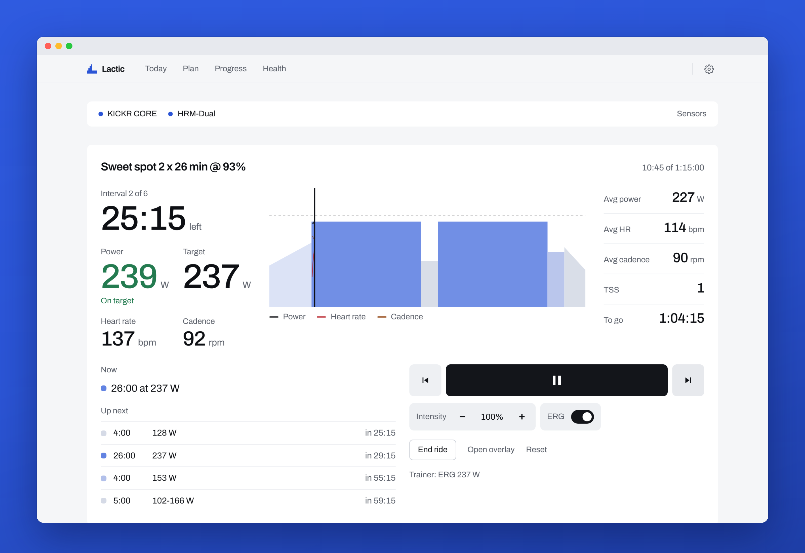
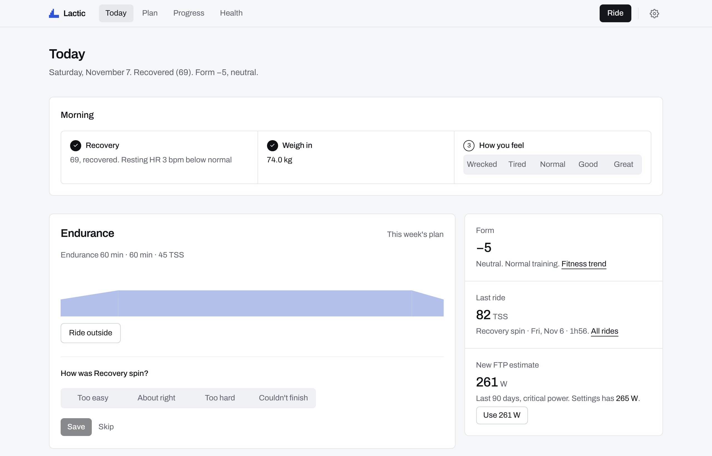
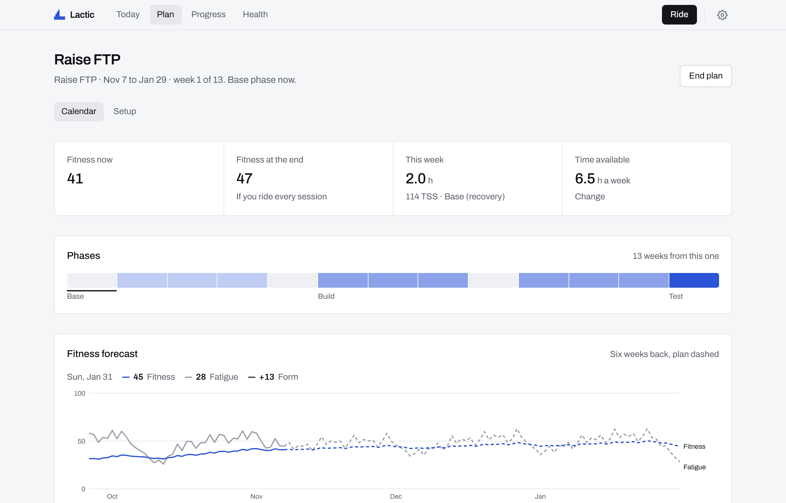
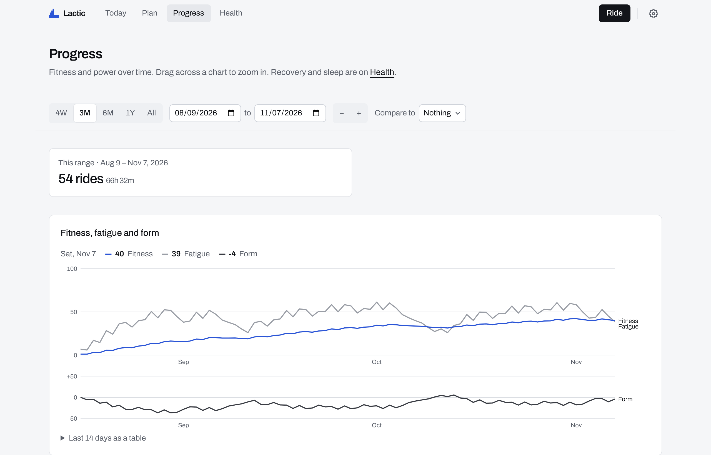
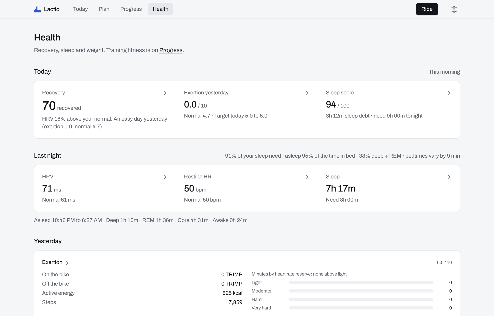
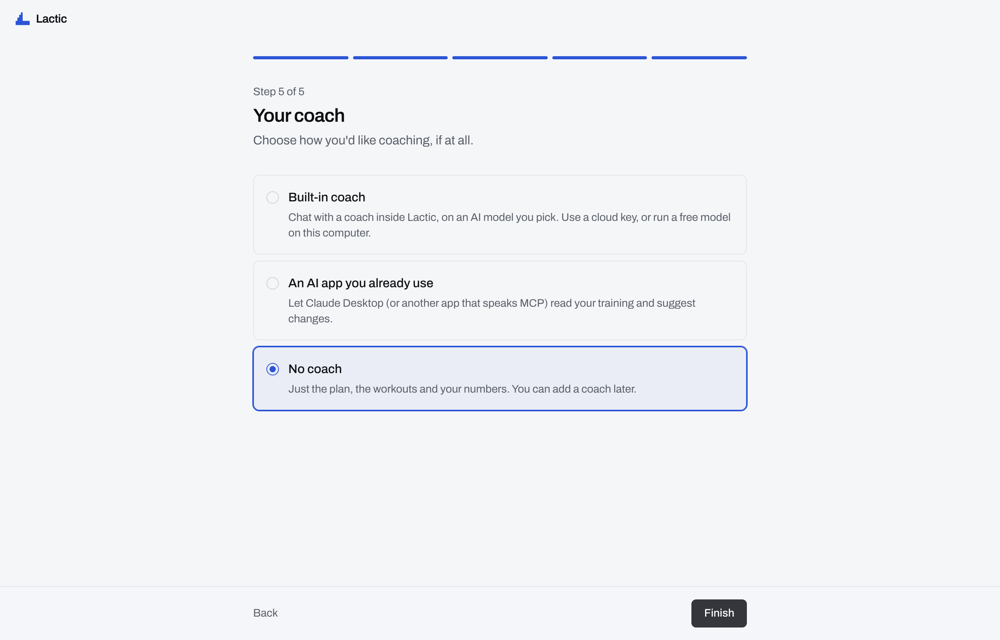

<div align="center">


# Lactic

**The open-source training platform.**

A training plan that fits your week, workouts on your smart trainer, and your recovery in one place.<br>
Free, on your computer, with the AI coach of your choice. Or none.

[**Download**](https://github.com/blairj09/lactic/releases/latest) · [MIT licensed](LICENSE) · [lactic.fit](https://lactic.fit) · [Build from source](#build-from-source) · [Contributing](#contributing)

</div>

<p align="center">
  
</p>

---

Your fitness shouldn't live on someone else's server, and your coach shouldn't be a subscription. So we built the alternative, and we're giving it away.

- **Your data is yours.** Every ride, plan and night of sleep sits in one file on your computer. No account. Back it up like any other file.
- **Your coach is your call.** Use any AI key, a free model on your own computer, or Claude Desktop through Lactic's MCP server. Or no coach at all.
- **The math is open.** Your plan, zones and fitness come from rules anyone can read. The AI explains and suggests. It never invents a number or changes your plan without you.
- **Your gear is welcome.** Keep Zwift open for the roads. Lactic runs the trainer; Zwift reads power, cadence and heart rate.

## What it does

### Every morning, one screen

Your recovery, your weight and how you feel. Today's workout, with **Ride it** one click away. Your form, your last ride, and a new FTP estimate when your rides call for one.



### Rides that hold the watts

Lactic sets the watts for every interval and drops to road mode for sprints. The workout starts with your first pedal stroke, and paired gear reconnects on its own.

The overlay keeps the workout on top of other windows, full screen included: Zwift, a video, a browser. Want more at the end? Extend with a free ride, a held ERG target or another block.

### Plans that adapt

Pick a goal (an event, a higher FTP, getting fitter or staying consistent) and the time you have each day. Lactic builds the phases and recovery weeks, forecasts your fitness to the end, and adjusts each morning for sleep, HRV and how yesterday felt.

Click a day to change it or ride it outside. Drag it to swap days.



### Progress you can trust

Fitness, fatigue and form. FTP from critical power, your power curve and profile, VO2 max. All calculated on your computer by an engine with tests behind it. Compare any range with the one before, or with last year.



### Recovery from the watch you already wear

A daily recovery score from sleep, HRV and resting heart rate, plus sleep stages and weight. Click any number for its history.



| Your device | How it gets to Lactic |
| --- | --- |
| **Apple Watch** | An iPhone Shortcut saves your nights to a synced folder (iCloud Drive, Dropbox, Google Drive, Nextcloud or Syncthing). Lactic picks them up. |
| **Garmin, Oura, WHOOP** (and Polar, Coros, Suunto) | Link it to [intervals.icu](https://intervals.icu), then connect intervals.icu to Lactic. |
| **Android** (Samsung, Pixel Watch, Fitbit) | [Health Sync](https://play.google.com/store/apps/details?id=nl.appyhapps.healthsync) sends Health Connect to intervals.icu. Lactic walks you through it. |
| **Smart scale** | Hume Body Pod over Bluetooth, or type your weight in. |

**intervals.icu** also brings in your ride history from Zwift, Garmin, Wahoo and most other apps, so your fitness is right from day one. Rides and planned workouts sync back.

### Bring your own AI (or none)



| Coach mode | What you get |
| --- | --- |
| **Built-in coach** | Chat inside Lactic on a model you pick: OpenRouter, Anthropic, OpenAI, Gemini, any OpenAI-compatible API, or a free model on your computer with Ollama or LM Studio. A morning brief and weekly workout picks with reasons. |
| **An AI app you already use** | Lactic runs an MCP server on your computer. One click adds it to Claude Desktop; any MCP app can connect. It gets the same tools as the built-in coach. |
| **No coach** | Just the plan, the workouts and your numbers. Nothing leaves your computer. |

Either coach reads the engine's numbers through tools and **suggests** changes. You apply or dismiss them. It can also check your gear and connections, and try a reconnect when something's off. Keys live in your OS keychain, never in the screens or the AI.

Cloud models stop at a monthly limit you set (default $10), so there are no surprise bills. [Choosing a coach model](docs/coach-models.md) lists good picks per provider, rough monthly costs and what leaves your computer.

### Easy to start

About five minutes, five steps: you, your week and goal, your gear, your rides and sleep, your coach. Skip anything you don't have. A short tour shows you around after.

## Download

Get the latest version from [**GitHub Releases**](https://github.com/blairj09/lactic/releases/latest).

| Platform | File | First launch |
| --- | --- | --- |
| **macOS** (Apple silicon) | `Lactic_*_aarch64.dmg` | Drag Lactic to Applications, then run `xattr -cr /Applications/Lactic.app` once in Terminal. |
| **Windows** | `Lactic_*_x64-setup.exe` | SmartScreen warns about an unknown publisher: choose **More info → Run anyway**. |
| **Linux** | `Lactic_*_amd64.AppImage` or `.deb` | `chmod +x Lactic_*.AppImage` and run it, or `sudo apt install ./Lactic_*_amd64.deb`. Bluetooth needs BlueZ; keys are stored via the Secret Service (GNOME Keyring or KWallet). |

> [!NOTE]
> Lactic isn't code-signed yet, which is why macOS and Windows ask for those extra steps. Windows and Linux builds are new and haven't had much riding on real hardware yet. Bug reports are very welcome.

## Quick start

1. **Install** Lactic and open it.
2. **About you:** FTP (or "I don't know"), weight and, if you like, max heart rate.
3. **Your week and goal:** how long you can ride each day and what you're training for. Lactic builds the plan.
4. **Your gear:** spin the trainer and put the strap on (or turn on heart rate broadcast on your watch). Lactic finds them.
5. **Your rides and sleep:** an intervals.icu key brings in your history. Pick your watch for recovery.
6. **Your coach:** pick one, or go without. Change any of it later in Settings.

Then press **Ride**. Riding with Zwift too? Pair the trainer in Zwift for power and cadence only, and leave control to Lactic.

## Build from source

Lactic is a [Tauri 2](https://tauri.app) app: React screens in a web view, with a Rust core for SQLite, Bluetooth LE, the keychain, HTTP and the MCP server.

```sh
git clone https://github.com/blairj09/lactic.git
cd lactic/app
npm ci
npm run dev       # in a browser at http://localhost:1420, with simulated sensors
npx tauri dev     # the desktop app (needs Rust: https://rustup.rs)
npx tauri build   # installers in src-tauri/target/release/bundle
```

You'll need Node 22 and, for the desktop app, stable Rust. On Linux also install `libwebkit2gtk-4.1-dev libayatana-appindicator3-dev librsvg2-dev libdbus-1-dev pkg-config`.

See [app/README.md](app/README.md) for how the app is put together.

```
app/
  web/lib/engine/   training engine: load, zones, fitness, plans (pure TypeScript, tested)
  web/              screens and data code
  src/              desktop shell: SQLite schema, Bluetooth, setup, tour, coach tools
  src-tauri/        Rust core: db.rs, ble.rs, secrets.rs, net.rs, mcp.rs, window.rs
site/               lactic.fit
```

## Contributing

Lactic is built by riders, in the open. Issues and pull requests are welcome, whether that's a bug on your trainer, support for new gear or a health source, or a better workout.

The quickest way to tell us something is the speech bubble at the top of the app: write a note, add a screenshot and circle the problem, and send. No GitHub account needed; it arrives here as an issue.

Before you open a pull request, run the checks in `app/`:

```sh
npm run typecheck && npm run lint && npm test && npx vite build
(cd src-tauri && cargo check)   # when Rust changed
```

Changing the coach's prompt or tools? `npm run eval:coach` scores it across models. See [app/evals](app/evals/README.md).

A few house rules keep Lactic trustworthy:

- **The engine owns every number.** The AI coach reads engine outputs through tools and proposes changes; it never computes metrics.
- **Keep the core portable.** `web/lib/engine`, `web/lib/fit`, `web/lib/ride` and the Bluetooth protocol code stay free of browser and Node APIs so they run anywhere and test in Vitest.
- **One GATT write at a time,** through `SensorHub`'s queue.
- **Migrations only add.** New tables and columns, never drops or renames. Every table has a UUID `id` and `updated_at`, so sync can come later.
- **Secrets stay in the OS keychain.** The UI only ever sends `keychain:<name>` placeholders.

## License

[MIT](LICENSE). Use it, fork it, ship it. Just keep the copyright notice.

---

<div align="center">
<sub>No accounts. No subscriptions. No lock-in. · <a href="https://lactic.fit">lactic.fit</a></sub>
</div>
