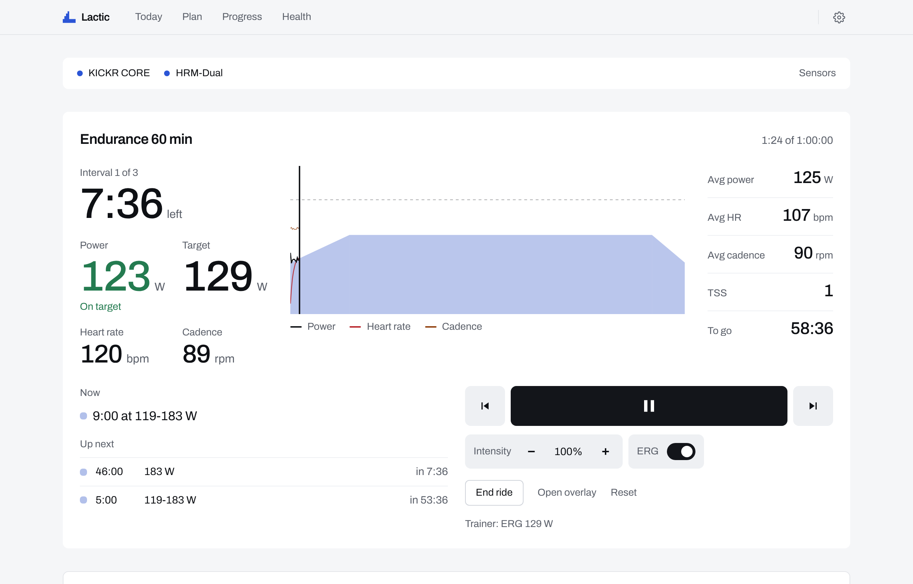

<div align="center">


# Lactic

**The open-source training platform.**

Structured cycling training that runs on your computer, rides your smart trainer in ERG,<br>
and lets you bring your own AI coach. Or no coach at all.

[**Download**](https://github.com/blairj09/lactic/releases/latest) · [lactic.fit](https://lactic.fit) · [Build from source](#build-from-source) · [Contributing](#contributing)


</div>

---

Your fitness shouldn't live on someone else's server, and your coach shouldn't be a subscription. So we built the alternative, and we're giving it away.

- **Your data is yours.** Every ride, plan and night of sleep sits in one SQLite file on your computer. No account to make, nothing to export when you leave. Back it up like any other file.
- **Your coach is your call.** Plug in any AI key, run a model on your own machine, or connect the Claude or ChatGPT you already pay for through Lactic's built-in MCP server. Rather ride in peace? Turn the coach off.
- **The math is open.** Your plan, zones and fitness come from rules anyone can read. The AI explains and suggests. It never invents a number, and it never changes your plan without you.
- **Your gear is welcome.** Keep Zwift open for the roads. Lactic holds the trainer; Zwift reads power, cadence and heart rate.

## What it does

### Rides that hold the watts

Lactic drives your smart trainer in ERG for every interval, drops to road mode for sprints, and starts the workout with your first pedal stroke. Paired gear reconnects on its own. An always-on-top overlay floats over full-screen Zwift, so you see the next interval without switching windows.



### Plans that adapt

Pick a goal (an event, a higher FTP, general fitness or consistency) and the hours you have each day. Lactic builds a base, build and peak plan with recovery weeks, forecasts your fitness to the end, and adjusts each morning for sleep, HRV and how yesterday felt. Drag days to swap them; edit any workout.


### Progress you can trust

Fitness, fatigue and form, FTP estimates from critical power, a power profile and power distribution, calculated on your machine by an engine with tests behind it. Compare any range with the one before it, or with last year.


### Recovery from the health data you already have

A morning recovery score from sleep, HRV and resting heart rate, plus weigh-ins and sleep stages.


| Source | How it gets to Lactic |
| --- | --- |
| **Apple Watch / Apple Health** | An iPhone Shortcut saves your nights to iCloud Drive (or Dropbox, Nextcloud, Syncthing); Lactic picks each file up. |
| **Garmin, Oura, WHOOP, Polar, Coros, Suunto** | Through [intervals.icu](https://intervals.icu) wellness: connect once, Lactic reads sleep, HRV, resting HR and weight. |
| **Android: Samsung, Pixel Watch, Fitbit** | [Health Sync](https://play.google.com/store/apps/details?id=nl.appyhapps.healthsync) passes Health Connect data to intervals.icu; Lactic walks you through it. |
| **Smart scales** | Hume Body Pod over Bluetooth, or type your weight in. |

**intervals.icu** also brings in your ride history from Zwift, Garmin, Wahoo, Hammerhead and most others, so Lactic knows your fitness from day one, and two-way sync sends rides and planned workouts back.

### Bring your own AI (or none)


| Coach mode | What you get |
| --- | --- |
| **Built-in coach** | Chat inside Lactic on the model you pick: OpenRouter, Anthropic, OpenAI, Google Gemini, any OpenAI-compatible API, or a free local model with Ollama or LM Studio. A morning brief, weekly workout picks with reasons, and a "Test this model" check before you commit. |
| **An AI app you already use** | Lactic runs an MCP server on your machine. One click adds it to Claude Desktop; any MCP client can connect. The external AI gets the same tools as the built-in coach. |
| **No coach** | The plan still builds and adapts. Nothing leaves your computer. |

Whichever you pick, the coach reads engine numbers through tools and **proposes** changes you approve with a button. It can also look after the app: check your Bluetooth gear and connected services, try a reconnect or a test sync, and suggest a setting when something's off. API keys live in your OS keychain and never reach the screens or the AI.

### Easy to start

A five-minute setup finds your trainer and sensors, builds your first plan, brings in your history and picks your coach. A short tour shows you around each screen and the Ride screen.

## Download

Get the latest version from [**GitHub Releases**](https://github.com/blairj09/lactic/releases/latest).

| Platform | File | First launch |
| --- | --- | --- |
| **macOS** (Apple silicon) | `Lactic_*_aarch64.dmg` | Drag Lactic to Applications, then run `xattr -cr /Applications/Lactic.app` once in Terminal. |
| **Windows** | `Lactic_*_x64-setup.exe` | SmartScreen warns about an unknown publisher: choose **More info → Run anyway**. |
| **Linux** | `Lactic_*_amd64.AppImage` or `.deb` | `chmod +x Lactic_*.AppImage` and run it, or `sudo apt install ./Lactic_*_amd64.deb`. Bluetooth needs BlueZ; keys are stored via the Secret Service (GNOME Keyring or KWallet). |

> [!NOTE]
> Lactic isn't code-signed yet, which is why macOS and Windows ask for those extra steps. Windows and Linux builds are new and haven't had much riding on real hardware yet. Bug reports are very welcome.

## Quick start

1. **Install** Lactic and open it.
2. **Tell it about you:** FTP (or "I don't know"), weight and, optionally, max heart rate.
3. **Set your week:** how long you can ride each day and what you're training for. Lactic builds the plan.
4. **Wake your gear:** spin the trainer, put the HR strap on. Lactic finds them over Bluetooth.
5. **Bring in your history and health** with an intervals.icu API key and, if you have an Apple Watch, the Health Shortcut.
6. **Pick a coach,** or skip it. You can change every choice later in Settings.

Then hit **Ride**. If Zwift is open too, pair your trainer in Zwift for power and cadence only, and leave control to Lactic.

## Build from source

Lactic is a [Tauri 2](https://tauri.app) app: React screens in a web view, with a Rust core for SQLite, Bluetooth LE, the keychain, HTTP and the MCP server.

```sh
git clone https://github.com/blairj09/lactic.git
cd lactic/app
npm ci
npm run dev       # in a browser at http://localhost:1420, with simulated sensors
npx tauri dev     # the desktop app (needs Rust: https://rustup.rs)
npx tauri build   # installers in src-tauri/target/release/bundle
```

You'll need Node 22 and, for the desktop app, stable Rust. On Linux also install `libwebkit2gtk-4.1-dev libayatana-appindicator3-dev librsvg2-dev libdbus-1-dev pkg-config`.

See [app/README.md](app/README.md) for how the app is put together.

```
app/
  web/lib/engine/   training engine: load, zones, fitness, plans (pure TypeScript, tested)
  web/              screens and data code
  src/              desktop shell: SQLite schema, Bluetooth, setup, tour, coach tools
  src-tauri/        Rust core: db.rs, ble.rs, secrets.rs, net.rs, mcp.rs, window.rs
site/               lactic.fit
```

## Contributing

Lactic is built by riders, in the open. Issues and pull requests are welcome, whether that's a bug on your trainer, support for new gear or a health source, or a better workout.

Before you open a pull request, run the checks in `app/`:

```sh
npm run typecheck && npm run lint && npm test && npx vite build
(cd src-tauri && cargo check)   # when Rust changed
```

A few house rules keep Lactic trustworthy:

- **The engine owns every number.** The AI coach reads engine outputs through tools and proposes changes; it never computes metrics.
- **Keep the core portable.** `web/lib/engine`, `web/lib/fit`, `web/lib/ride` and the Bluetooth protocol code stay free of browser and Node APIs so they run anywhere and test in Vitest.
- **One GATT write at a time,** through `SensorHub`'s queue.
- **Migrations only add.** New tables and columns, never drops or renames. Every table has a UUID `id` and `updated_at`, so sync can come later.
- **Secrets stay in the OS keychain.** The UI only ever sends `keychain:<name>` placeholders.

## License

License to be decided. Until a license file is added, all rights are reserved.

---

<div align="center">
<sub>No accounts. No subscriptions. No lock-in. · <a href="https://lactic.fit">lactic.fit</a></sub>
</div>
