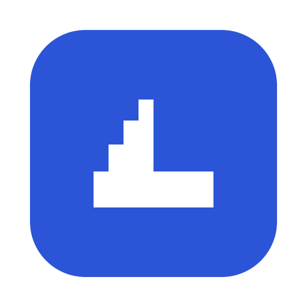

# Lactic for Claude



[Lactic](https://lactic.fit) is a free, open-source app for structured cycling training. It runs on your computer: it controls your smart trainer, records your rides, builds your plan and tracks your fitness and recovery, and it keeps all of that in a database on your computer.

This plugin lets Claude be your coach. Claude reads your plan, rides, power, fitness, fatigue, form and recovery from Lactic, answers questions about your training, and suggests changes such as a different workout today, a rest day or a new plan. Suggestions change nothing until you press Apply in Lactic or on Lactic's card in the chat.

## What you need

- Lactic on your computer, free from [lactic.fit](https://lactic.fit) or with Homebrew: `brew install --cask blairj09/lactic/lactic`. Open it once.
- In Lactic, Settings → Coach set to "An AI app you already use", or let AI apps connect alongside the built-in coach.
- macOS or Linux. On Windows, add Lactic to Claude from Lactic's Settings → Coach instead.

## Install

In Claude Code:

```
/plugin install lactic --marketplace blairj09/lactic
```

On claude.ai and in Cowork, add Lactic from Customize → Plugins once it's listed in Claude's plugin directory.

## What's in the plugin

- **Lactic's tools (a local MCP server).** The plugin runs `scripts/lactic-mcp.sh`, which finds Lactic where it's installed (`/Applications/Lactic.app`, `/usr/bin/lactic`, or `/Applications/Lactic Preview.app`) and starts `lactic --mcp`. That is Lactic's own built-in bridge: it passes Claude's requests to the Lactic app over 127.0.0.1 on your computer, opening Lactic if it's closed. The plugin contains no other code and downloads nothing.
- **A coaching skill** that tells Claude how to use Lactic's tools: start from the overview, quote Lactic's numbers instead of working them out, and suggest changes for you to apply.

Lactic's MCP server loads in Claude Code and in Cowork sessions on your computer. Claude's chat doesn't start plugin servers, so for chat in the Claude desktop app use the button in Lactic's Settings → Coach, which adds Lactic there directly.

## Tools

Tools that only read: `get_overview`, `get_athlete`, `get_plan`, `get_events`, `get_rides`, `get_ride`, `get_fitness`, `get_power`, `get_recovery`, `get_body`, `get_workouts`, `get_day_options`, `get_layout`, `check_app`, `list_plugins`, `read_plugin_metric`.

Tools that suggest a change for you to apply in Lactic: `propose_workout`, `propose_swap`, `propose_day_change`, `propose_reset_day`, `propose_break`, `propose_availability`, `propose_event`, `propose_plan`, `propose_app_change`, `propose_layout_change`.

Tools that act straight away: `remember` and `forget` (facts about you that Claude should keep in mind), `set_appearance` (light or dark theme), and `sync_now`, `test_connection`, `scan_for_devices`, `reconnect_device` for checking your gear and intervals.icu sync. None of them reads or returns an API key, and while a ride is under way only reading and the theme are allowed.

## Examples

- "What should I ride today?" Claude reads your overview and recommends today's workout, or an easier one if your recovery is low.
- "How did yesterday's threshold ride go?" Claude reads the ride and compares each interval with its target.
- "I'm travelling Thursday to Sunday. Move my key workouts." Claude suggests the moved days, and you apply them in Lactic.
- "Am I on track for my race in six weeks?" Claude reads your fitness trend and event and suggests a plan change if you need one.

## Privacy policy

Lactic keeps your training on your computer. There's no Lactic account and no Lactic server holding your rides, health or settings. With this plugin, Claude reads the training data its tools return (plan, rides, fitness and recovery numbers, and facts you asked it to remember) from the Lactic app on your computer, over 127.0.0.1. That data then goes to Claude as part of your conversation, under [Anthropic's privacy policy](https://www.anthropic.com/legal/privacy). The plugin sends nothing anywhere else and keeps nothing itself; Lactic keeps your data until you delete it in Settings → Your data. Lactic isn't aimed at children under 13. The full policy is at [lactic.fit/privacy](https://lactic.fit/privacy/). Questions: help@lactic.fit.

## Support

Email help@lactic.fit, open an issue at [github.com/blairj09/lactic](https://github.com/blairj09/lactic/issues), or use Send feedback in Lactic.

## License

MIT. Lactic and the Lactic logo are trademarks of James Blair; see [TRADEMARKS.md](https://github.com/blairj09/lactic/blob/main/TRADEMARKS.md).
